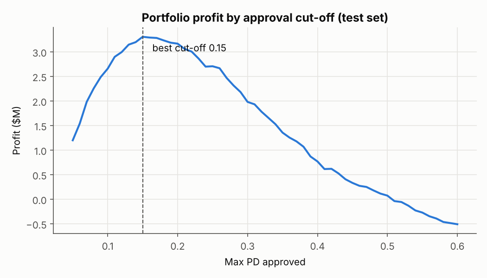
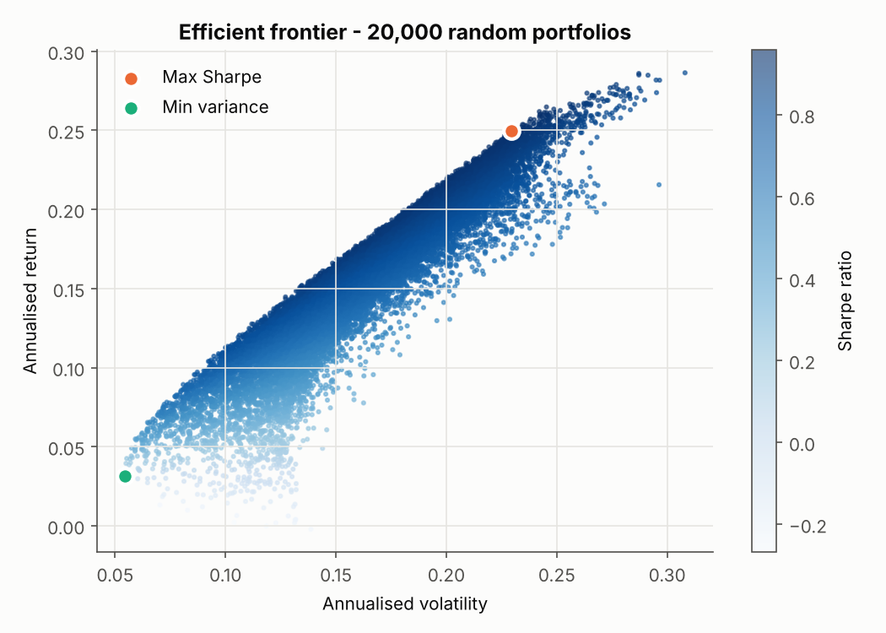
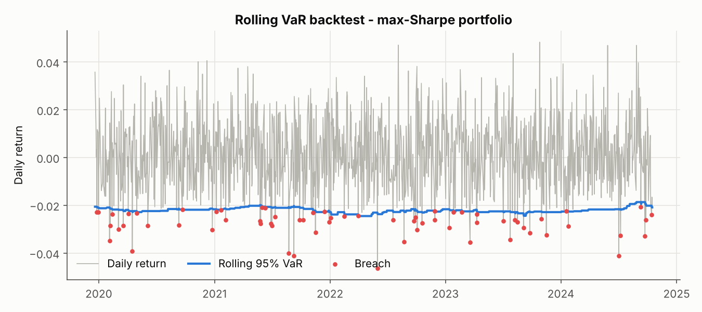
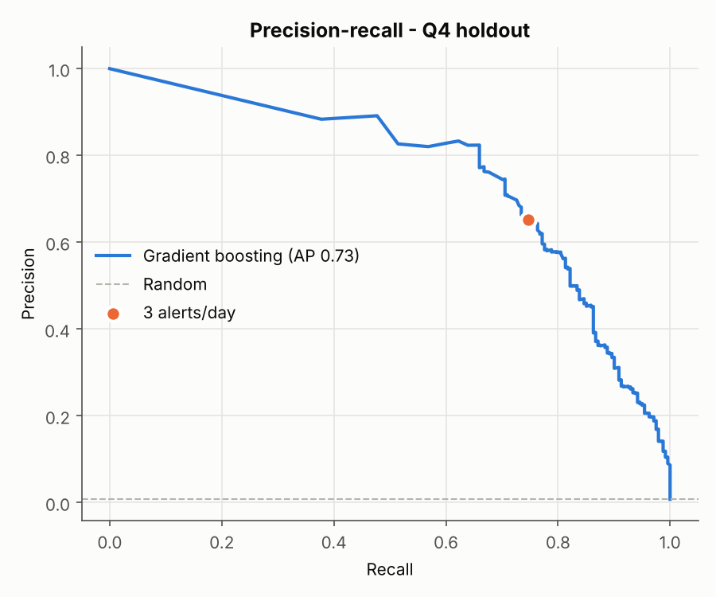

# Finance-ds

This repository contains four projects that answer practical business questions in finance and banking, and my approach to answering them as a data scientist. It also has a graded set of practice exercises.
Every project starts with a business question and ends with a decision and a dollar figure, not just a model score.

| # | Project | Business question | Key techniques | Headline result |
|---|---------|-------------------|----------------|-----------------|
| 1 | [Credit risk PD model](projects/p01_credit_risk.py) | Which loans should we approve? | IV screening, logistic regression vs gradient boosting, AUC/Gini/KS, profit-based cut-off | AUC 0.73 · cut-off at PD 0.15 turns a **-$0.5M** book into **+$3.3M** |
| 2 | [Portfolio & market risk](projects/p02_portfolio_risk.py) | Best risk-adjusted mix, and how much can we lose? | Sharpe, drawdown, efficient frontier, historical/parametric VaR & CVaR, VaR backtest | Max-Sharpe portfolio 0.96 · VaR breach rate 5.2% vs 5% target |
| 3 | [Card fraud detection](projects/p03_fraud_detection.py) | Which transactions do analysts review? | Leak-free behavioural features, time-ordered split, imbalanced learning, capacity-based threshold | 3 alerts/day → **75% of fraud caught at 65% precision** (base rate 0.8%) |
| 4 | [Customer segmentation](projects/p04_customer_segmentation.py) | Who do we target with which offer? | RFM, scaling, K-Means, silhouette selection, segment profiling | 4 segments; 51% of customers drive 78% of spend |

<p>




</p>

## Quick start

```bash
pip install -r requirements.txt
python data/generate_data.py                 # reproducible synthetic data (no API keys)
python projects/p01_credit_risk.py           # each project prints results + saves charts to reports/figures/
pytest                                       # library tests + exercise grader
```

## Layout

```
data/generate_data.py   seeded synthetic loans, prices (correlated GBM) and card transactions
fintools/               reusable library: TVM (loan payment, NPV, IRR), returns, Sharpe, drawdown,
                        VaR/CVaR, KS, Gini, Information Value + shared chart style
projects/               the four portfolio projects
exercises/practice.py   14 exercises to complete (Levels 1-3)
exercises/solutions.py  reference answers
tests/                  unit tests for fintools + auto-grader for exercises
```

## Practice mode

`exercises/practice.py` has 14 stub functions, from compound interest up to VaR and model-cost analysis.
Fill them in and run the grader:

```bash
pytest tests/test_exercises.py -x                    # stops at your first failing exercise
EXERCISES=solutions pytest tests/test_exercises.py   # confirms the reference answers
```

## Practice roadmap (to strengthen the portfolio)

1. **Solve all 14 exercises** without looking at solutions, then compare your answers with them.
2. **Extend each project** (good interview talking points):
   - Credit: build a points-based scorecard (WoE binning → 600 + 20·log2 odds), add SHAP explanations, and check the model for fairness across groups.
   - Portfolio: replace random sampling with `scipy.optimize`, add a monthly rebalanced backtest, and stress test against a 2008-style shock.
   - Fraud: add rolling 1h/24h velocity features and compare with Isolation Forest (unsupervised).
   - Segmentation: map segments to products and estimate the uplift of a campaign.
3. **Swap in real data**: Kaggle *Give Me Some Credit* / *Lending Club* (credit), `yfinance` (prices),
   Kaggle *Credit Card Fraud* (fraud). The pipelines need few changes.
4. **Ship one as an app**, such as a Streamlit loan-decision demo, and link it at the top of this README.
5. **Write one short blog post per project** focused on the business decision, not the algorithm.

> Data is synthetic and generated with known risk drivers, so you can check that the models recover them.
